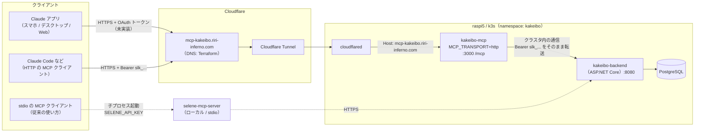
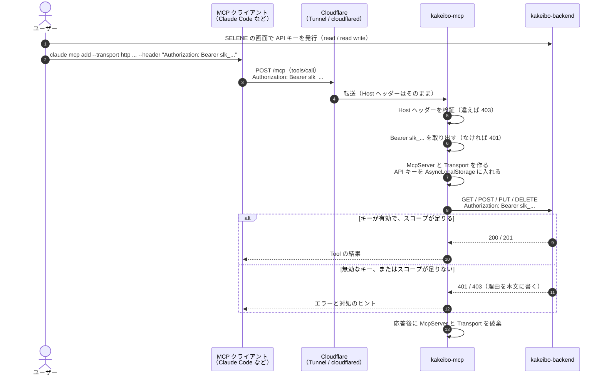
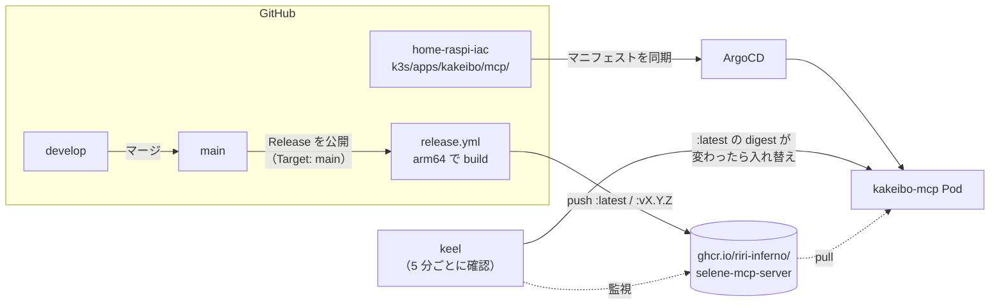

# k3s に常駐させる MCP サーバーのアーキテクチャ

selene-mcp-server を自宅の k3s（raspi5）に Pod として常駐させ、Streamable HTTP で公開する構成。スマホやデスクトップの Claude アプリから、ローカルに何も入れずに SELENE の取引を読み書きできるようにする（Riri-Inferno/ServerlessKakeibo#100）。

接続の方法は 2 つ。

- **API キーで接続**：SELENE の画面で発行した API キーを、`Authorization` ヘッダーで渡す。Claude Code など、ヘッダーを設定できるクライアント向け
- **OAuth で接続**（未実装）：ユーザーは SELENE の既存のログイン（Google / GitHub）で承認するだけでよく、API キーを手で発行して貼る必要がない。Claude アプリのカスタムコネクタ向け

特定のモデルやクライアントに縛られないように、MCP の標準（Streamable HTTP と MCP Authorization）に沿って作る。

## 全体の構成

ポイント:

- **MCP サーバーは秘密情報を持たない**。受け取った API キーを backend に転送するだけで、認証と認可（`read` / `read write` スコープ）は SELENE 本体が判断する
- **ステートレス**。セッションを持たず、`POST /mcp` のたびに McpServer を作って捨てる。Pod を再起動しても、台数を増やしても、クライアント側には影響がない
- **stdio も残す**。`MCP_TRANSPORT` の既定は stdio なので、ローカルで子プロセスとして起動する従来の使い方はそのまま動く

## API キーで接続する

## OAuth で接続する（未実装）

Claude アプリのカスタムコネクタから、ユーザーごとに自分の SELENE アカウントで接続できるようにする。SELENE の backend を認可サーバーにし、MCP サーバーは受け取ったトークンを backend 宛ての短命なトークンに交換して API を呼ぶ。設計の選択肢、決定の理由、満たす必要がある仕様は [oauth-design.md](oauth-design.md) にまとめた。

## デプロイ

- マニフェストの変更は ArgoCD が反映する。イメージの更新は keel が反映する（ArgoCD の Sync ではイメージは更新されない）
- DNS レコードは `home-raspi-iac/terraform/cloudflare/dns.tf`、Tunnel の振り分けは `home-raspi-iac/k3s/apps/cloudflared/configmap.yaml` で管理する
