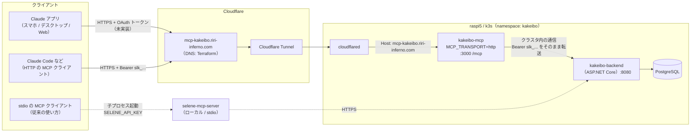
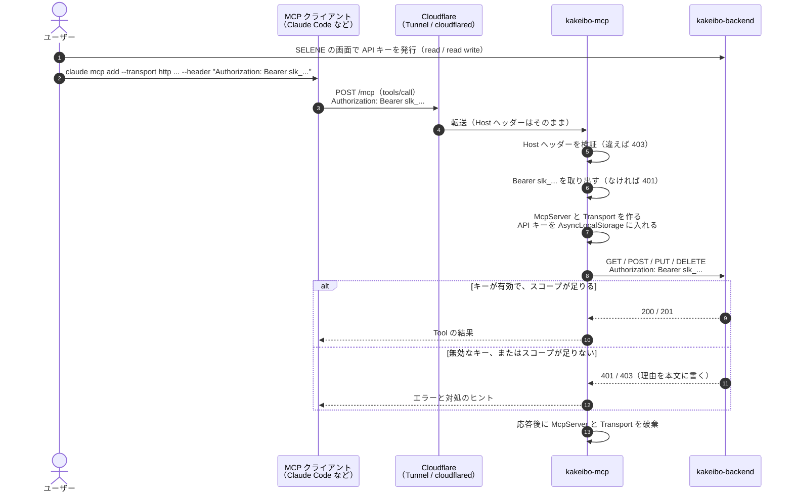
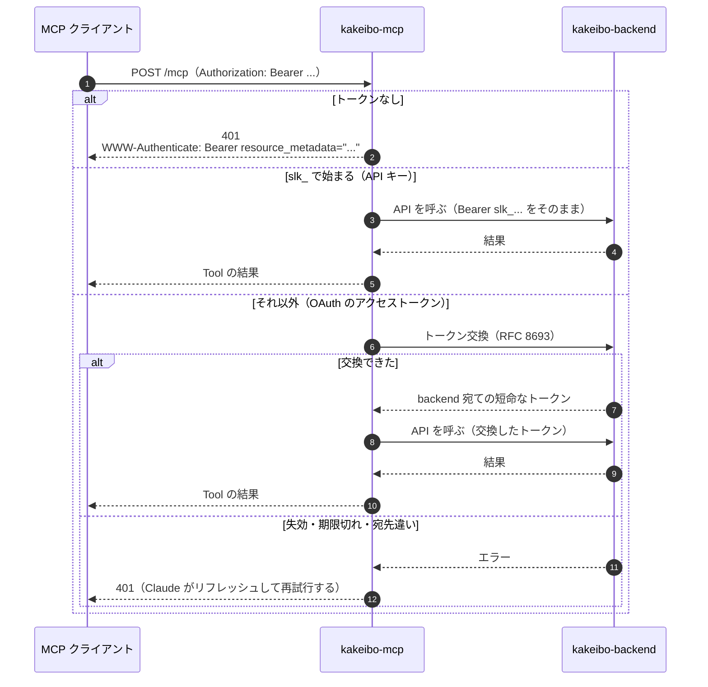
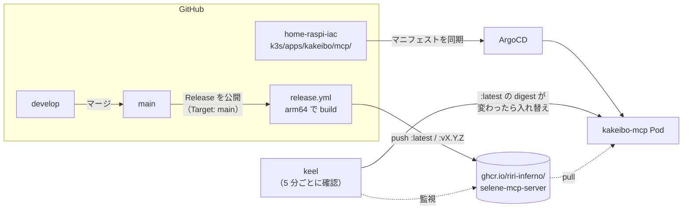

# k3s に常駐させる MCP サーバーのアーキテクチャ

selene-mcp-server を自宅の k3s（raspi5）に Pod として常駐させ、Streamable HTTP で公開する構成。スマホやデスクトップの Claude アプリから、ローカルに何も入れずに SELENE の取引を読み書きできるようにする（Riri-Inferno/ServerlessKakeibo#100）。

接続の方法は 2 つ。

- **API キーで接続**：SELENE の画面で発行した API キーを、`Authorization` ヘッダーで渡す。Claude Code など、ヘッダーを設定できるクライアント向け
- **OAuth で接続**（未実装）：ユーザーは SELENE の既存のログイン（Google / GitHub）で承認するだけでよく、API キーを手で発行して貼る必要がない。Claude アプリのカスタムコネクタ向け

特定のモデルやクライアントに縛られないように、MCP の標準（Streamable HTTP と MCP Authorization）に沿って作る。

## 全体の構成

ポイント:

- **MCP サーバーは秘密情報を持たない**。受け取った API キーを backend に転送するだけで、認証と認可（`read` / `read write` スコープ）は SELENE 本体が判断する
- **ステートレス**。セッションを持たず、`POST /mcp` のたびに McpServer を作って捨てる。Pod を再起動しても、台数を増やしても、クライアント側には影響がない
- **stdio も残す**。`MCP_TRANSPORT` の既定は stdio なので、ローカルで子プロセスとして起動する従来の使い方はそのまま動く

## API キーで接続する

## OAuth で接続する（未実装）

Claude アプリのカスタムコネクタから、ユーザーごとに自分の SELENE アカウントで接続できるようにする。SELENE の backend を OAuth の認可サーバーにし、MCP サーバーはリソースサーバーになる。

システム全体の設計（全体の流れ、方式を選んだ理由、満たす仕様）は SELENE 本体にまとめている。

- [mcp-oauth-design.md](https://github.com/Riri-Inferno/ServerlessKakeibo/blob/develop/Document/Architecture/mcp-oauth-design.md)：全体の設計
- [oauth-authorization-server.md](https://github.com/Riri-Inferno/ServerlessKakeibo/blob/develop/Document/Architecture/oauth-authorization-server.md)：backend の認可サーバーの実装

ここでは、MCP サーバーが受け持つことだけを書く（ServerlessKakeibo#109）。

### MCP サーバーの役割

- **Protected Resource Metadata（RFC 9728）を返す**：`/.well-known/oauth-protected-resource`（`/mcp` 付きのパスでも）で、次の内容を返す
  - `resource`：`https://mcp-kakeibo.riri-inferno.com/mcp`。backend の設定（`OAuth:McpResource`）と**文字列として完全に一致**させる。backend は resource を完全一致で照合するため
  - `authorization_servers`：backend の issuer（`https://api-kakeibo.riri-inferno.com/`）。Claude は先頭の 1 件だけを使う
  - `scopes_supported`：`read`、`write`
- **トークンがないときは 401 を返す**：`WWW-Authenticate: Bearer resource_metadata="..."` を付ける（`scope` も付ける）。Claude はこれを見て OAuth の接続を始める
- **トークンの種類で振り分ける**
  - `slk_` で始まる：API キー。今までどおり backend にそのまま転送する
  - それ以外：OAuth のアクセストークン。backend でトークン交換（RFC 8693）をして、backend 宛ての短命なトークンで API を呼ぶ（交換は ServerlessKakeibo#108）。受け取ったトークンをそのまま転送することは、MCP の仕様で禁止されている（MUST NOT）
  - 交換に失敗したら 401、スコープが足りなければ 403 と `error="insufficient_scope"`
- **状態も秘密情報も持たない**：トークンの検証は交換のときに backend が行う。MCP サーバーはトークンの中身を読まず、鍵も持たない

## デプロイ

- マニフェストの変更は ArgoCD が反映する。イメージの更新は keel が反映する（ArgoCD の Sync ではイメージは更新されない）
- DNS レコードは `home-raspi-iac/terraform/cloudflare/dns.tf`、Tunnel の振り分けは `home-raspi-iac/k3s/apps/cloudflared/configmap.yaml` で管理する
