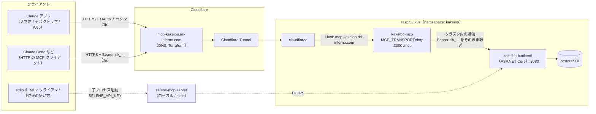
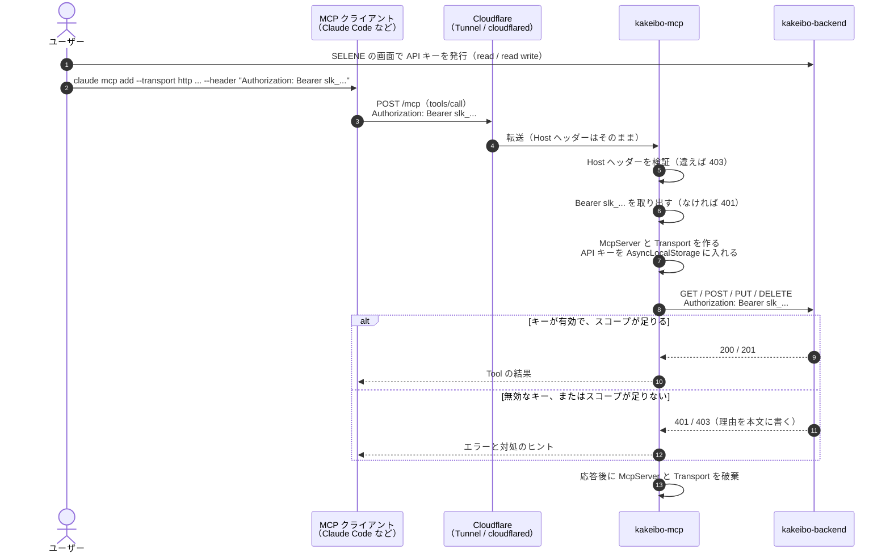
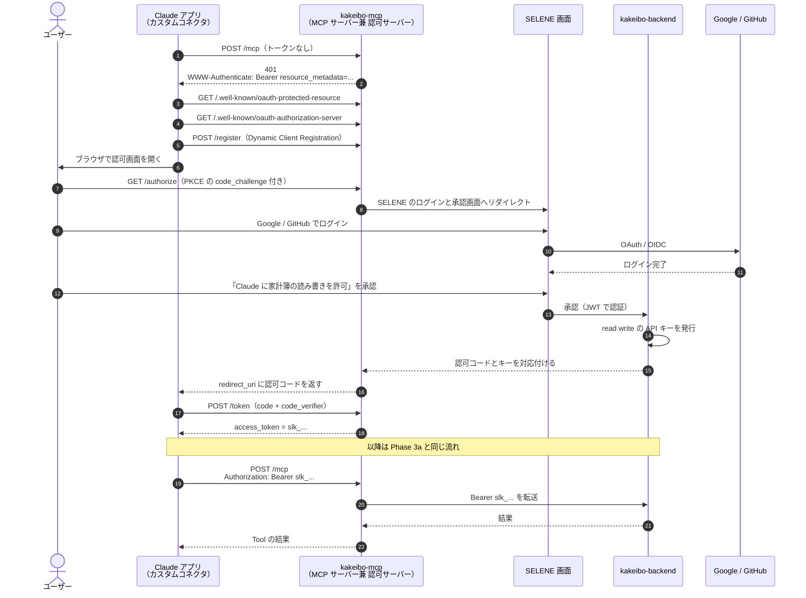
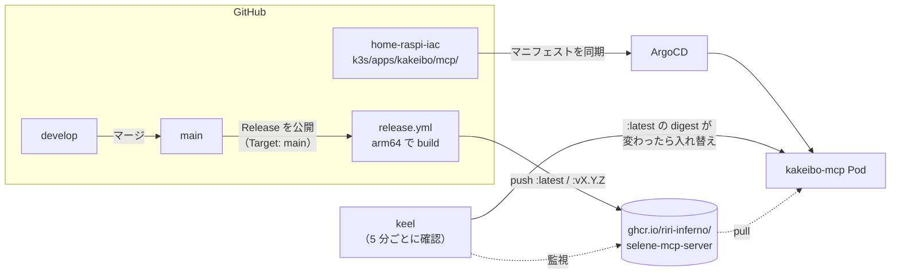

# アーキテクチャ（To-Be）

Issue Riri-Inferno/ServerlessKakeibo#100 で目指す構成。スマホやデスクトップの Claude アプリから、ローカルに何も入れずに SELENE の取引を読み書きできるようにする。

- **Phase 3a**：MCP サーバーを k3s の Pod として動かし、Streamable HTTP で公開する。認証は、`Authorization` ヘッダーで渡す API キー
- **Phase 3b**（予定）：OAuth に対応する。ユーザーは SELENE の既存のログイン（Google / GitHub）で承認するだけでよく、API キーを手で発行して貼る必要がなくなる

特定のモデルやクライアントに縛られないように、MCP の標準（Streamable HTTP と MCP Authorization）に沿って作る。

## 全体の構成

ポイント:

- **MCP サーバーは秘密情報を持たない**。受け取った API キー（3b では、OAuth のトークンとして発行された API キー）を backend に転送するだけで、認証と認可（`read` / `read write` スコープ）は SELENE 本体が判断する
- **ステートレス**。セッションを持たず、`POST /mcp` のたびに McpServer を作って捨てる。Pod を再起動しても、台数を増やしても、クライアント側には影響がない
- **stdio も残す**。`MCP_TRANSPORT` の既定は stdio なので、ローカルで子プロセスとして起動する従来の使い方はそのまま動く

## Phase 3a：API キーをヘッダーで渡す

## Phase 3b：OAuth で接続する（予定）

MCP の TypeScript SDK が提供する認可サーバーの部品を使い、ログインと承認には SELENE の既存の Google / GitHub ログインを使う。ユーザーが承認したら、SELENE が裏で `read write` の API キーを発行し、それを OAuth のアクセストークンとして返す。

トークンの実体が API キーなので、MCP サーバーから backend への転送（3a の仕組み）は変わらない。

未決事項（3b に入る前に調べる）:

- Claude のカスタムコネクタが求める要件。Dynamic Client Registration は必須か、リフレッシュトークンは必要か
- 認可コードと API キーを、MCP サーバーと backend のどちらが、どう対応付けて保持するか（MCP サーバーをステートレスに保てるか）
- 発行したキーを、SELENE の画面から「Claude 用」とわかる形で一覧・失効できるようにする
- Cloudflare の Bot Fight Mode が、claude.ai からの接続を止めないか

## デプロイ

- マニフェストの変更は ArgoCD が反映する。イメージの更新は keel が反映する（ArgoCD の Sync ではイメージは更新されない）
- DNS レコードは `home-raspi-iac/terraform/cloudflare/dns.tf`、Tunnel の振り分けは `home-raspi-iac/k3s/apps/cloudflared/configmap.yaml` で管理する
